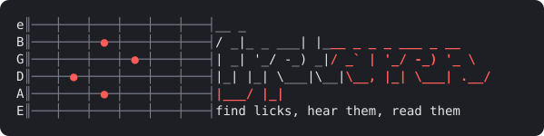

# fretgrep

[English](README.md) · **Deutsch**

<p align="center">
  
</p>

fretgrep macht eine Sammlung von Gitarren-Lick-Aufnahmen durchsuchbar. Der
Befehl dazu heißt `fretgrep`. Er liest die MP3-Dateien ein, schlägt aus den
Dateinamen Tags vor, schreibt gesprochene Erklärungen als Text mit und
findet Aufnahmen über Stichwörter oder über die Bedeutung der Suchanfrage.

Alles läuft lokal: die Daten liegen in einer SQLite-Datei, die
Spracherkennung läuft auf dem eigenen Rechner, die Suche nach Bedeutung
nutzt einen eigenen Ollama-Server.

## Schnellstart

```sh
python3 -m venv .venv && source .venv/bin/activate
pip install -e ".[dev,transcribe]"

export FRETGREP_LIBRARY=~/pfad/zu/den/aufnahmen
export FRETGREP_EMBED_MODEL=bge-m3:latest

fretgrep db upgrade     # Datenbank anlegen
fretgrep scan           # Aufnahmen einlesen
fretgrep transcribe     # optional: Gesprochenes mitschreiben
fretgrep embed          # optional: Vektoren für die Suche nach Bedeutung

fretgrep search trauriger blues von wes   # nach Bedeutung, wenn Ollama läuft
fretgrep search -k chet baker moll        # nur Stichwörter, alle müssen passen
fretgrep play 21 -s 0.7 # Aufnahme 21 mit 70 % Tempo abspielen
fretgrep search -n 5 blues --play         # die Treffer nacheinander abspielen
fretgrep search -n 5 hm5 --save "hm5 üben"   # Treffer in eine eigene Wiedergabeliste
fretgrep playlist show "hm5 üben" --play     # die Liste zeigen und abspielen
fretgrep notes 21       # gespielte Noten anzeigen (eigene Installation nötig)
fretgrep notes 21 --show            # dasselbe als Notenblatt im Fenster (braucht LilyPond)
fretgrep notes 21 --sheet lick.pdf   # das Notenblatt als Datei speichern
fretgrep notes 21 --sheet lick.pdf --rhythm   # mit geschätzten Notenwerten
fretgrep tones G7HM5    # Töne von Akkord und Skala, sofort
fretgrep chat welche Skala passt über Dm7b5   # den Assistenten fragen
fretgrep chat -c und welche Aufnahmen hab ich dazu   # daran anknüpfen
```

Befehle und Schalter lassen sich mit der Tab-Taste ergänzen, nach einmaliger
Einrichtung (`fretgrep completion --help`, ausführlich in der
[Benutzung](docs/benutzung.md#tab-vervollständigung)).

Für einzelne Befehle sind zusätzliche Programme nötig (ffmpeg, mpv,
LilyPond, ein Ollama-Server); die Liste steht in der
[Benutzung](docs/benutzung.md#voraussetzungen).

## Dokumentation

- [Benutzung](docs/benutzung.md): Installation, Einstellungen, alle Befehle,
  wann welcher Befehl nötig ist, Blick in die Datenbank.
- [Architektur](docs/architektur.md): Aufbau, Datenmodell, wie Einlesen und
  Suche funktionieren, Entwicklung und Tests.
- [Ursprünglicher Auftrag](docs/prompt.md): Ziele und Rahmenbedingungen.

## Stand

Vorhanden sind Einlesen, Tag-Vorschläge, eigene Tags und Notizen,
Stichwortsuche, Transkription, die Suche nach Bedeutung, die Wiedergabe
mit Tempo- und Tonhöhenänderung und die Anzeige der erkannten Noten als
Text, MIDI oder Notenblatt (als Datei oder im Fenster), auf Wunsch mit
geschätzten Notenwerten, ein Assistent für Fragen zu Harmonielehre und
Sammlung und die Tab-Vervollständigung.

## Lizenz

[MIT](LICENSE). Die Pflichtabhängigkeit mutagen steht unter
GPL-2.0-or-later und wird bei der Installation getrennt geladen.
