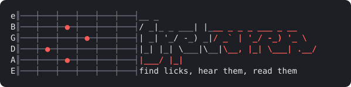

# fretgrep

**English** · [Deutsch](README.de.md)

<p align="center">
  
</p>

fretgrep makes a collection of guitar lick recordings searchable. The
command is called `fretgrep`. It reads in the MP3 files, suggests tags from
the file names, transcribes spoken explanations to text and finds
recordings by keywords or by the meaning of a search query.

Everything runs locally: the data lives in a SQLite file, speech
recognition runs on your own machine, and the search by meaning uses your
own Ollama server.

> **Note:** The command-line output and the detailed documentation in
> `docs/` are currently in German. Search queries work in English too: the
> tag vocabulary knows English terms (e.g. `minor`), and the search by
> meaning uses a multilingual model.

## Quick start

```sh
python3 -m venv .venv && source .venv/bin/activate
pip install -e ".[dev,transcribe]"

export FRETGREP_LIBRARY=~/path/to/recordings
export FRETGREP_EMBED_MODEL=bge-m3:latest

fretgrep db upgrade     # create the database
fretgrep scan           # read in the recordings
fretgrep transcribe     # optional: transcribe what is spoken
fretgrep embed          # optional: vectors for the search by meaning

fretgrep search sad blues by wes          # by meaning, if Ollama is running
fretgrep search -k chet baker minor       # keywords only, all must match
fretgrep play 21 -s 0.7 # play recording 21 at 70 % speed
fretgrep search -n 5 blues --play         # play the hits one after another
fretgrep search -n 5 hm5 --save "hm5 practice"   # save the hits to a playlist
fretgrep playlist show "hm5 practice" --play     # show and play the playlist
fretgrep notes 21       # show the notes played (extra installation needed)
fretgrep notes 21 --show            # the same as sheet music in a window (needs LilyPond)
fretgrep notes 21 --sheet lick.pdf   # save the sheet music to a file
fretgrep notes 21 --sheet lick.pdf --rhythm   # with estimated note values
fretgrep tones G7HM5    # notes of chord and scale, instantly
fretgrep chat which scale fits over Dm7b5     # ask the assistant
fretgrep chat -c and which recordings do I have for it   # follow up
```

Commands and options can be completed with the Tab key after a one-time
setup (`fretgrep completion --help`, details in the
[usage guide](docs/benutzung.md#tab-vervollständigung), German).

Some commands need additional programs (ffmpeg, mpv, LilyPond, an Ollama
server); the list is in the
[usage guide](docs/benutzung.md#voraussetzungen) (German).

## Documentation (German)

- [Usage](docs/benutzung.md): installation, settings, all commands, when
  which command is needed, a look into the database.
- [Architecture](docs/architektur.md): structure, data model, how reading
  in and search work, development and tests.
- [Original brief](docs/prompt.md): goals and constraints.

## Status

Available: reading in, tag suggestions, custom tags and notes, keyword
search, transcription, search by meaning, playback with tempo and pitch
changes, display of the detected notes as text, MIDI or sheet music (as a
file or in a window), optionally with estimated note values, an assistant
for questions about harmony and the collection, and Tab completion.

## License

[MIT](LICENSE). The required dependency mutagen is licensed under
GPL-2.0-or-later and is installed separately.
